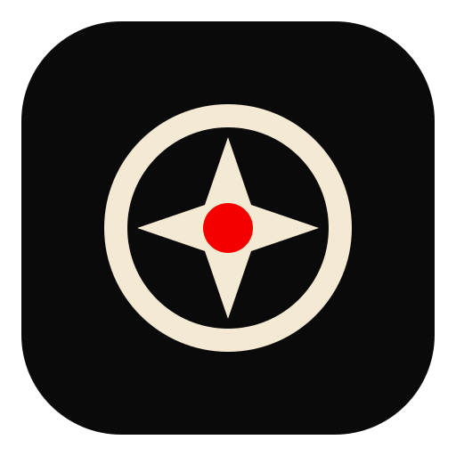
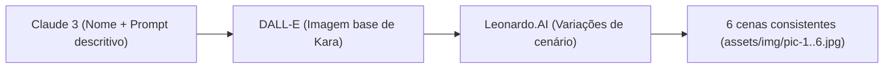
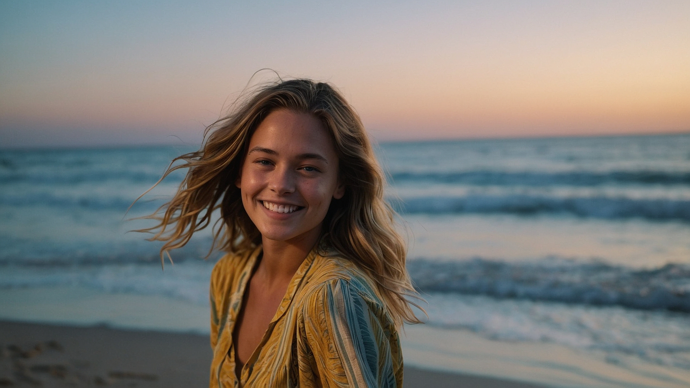
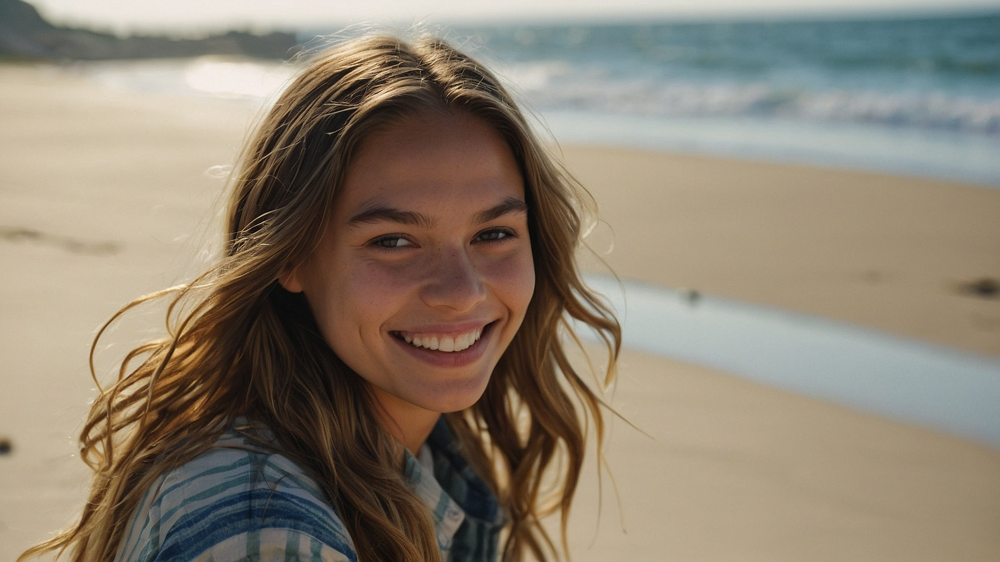
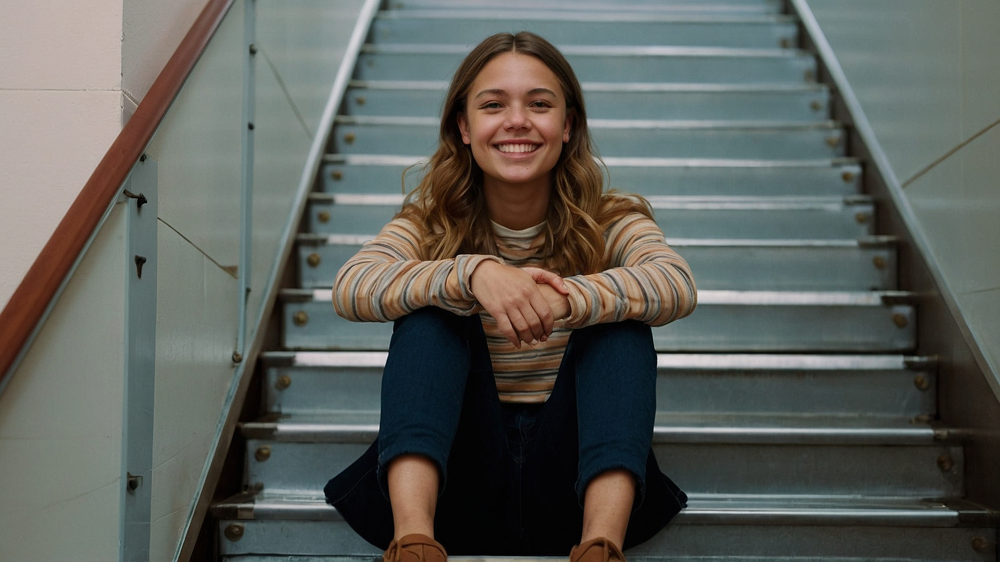
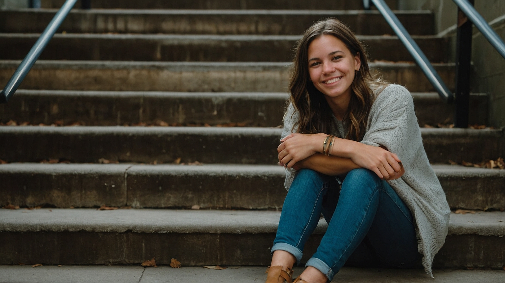
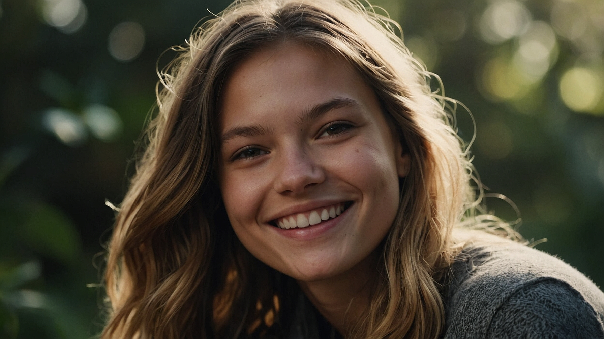
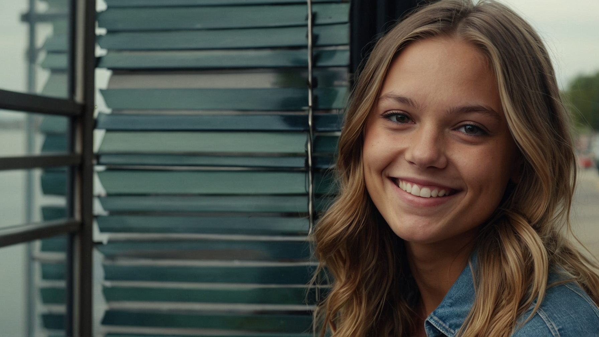

<a id="top"></a>

<div align="center">

<picture>
  <source media="(prefers-color-scheme: dark)" srcset="https://raw.githubusercontent.com/voaneves/lab-natty-or-not/main/assets/brand/logo-dark.svg" />
  <source media="(prefers-color-scheme: light)" srcset="https://raw.githubusercontent.com/voaneves/lab-natty-or-not/main/assets/brand/logo-light.svg" />
  
</picture>

<h1>lab-natty-or-not</h1>

<p>
  <strong>Estudo prático de consistência visual e ética na criação de uma influenciadora digital sintética com IA generativa.</strong><br />
  <sub>
    Laboratório desenvolvido para o Bootcamp Nexa (Fundamentos de IA Generativa e Claude 3 · DIO) —
    <kbd>Claude 3</kbd> · <kbd>DALL-E</kbd> · <kbd>Leonardo.AI</kbd>
  </sub>
</p>

<p><sub>Precisa explorar IA generativa com critério? <a href="https://voaneves.com/#contato"><strong>Vamos conversar →</strong></a></sub></p>

<p>
  
  
  
</p>

<p>
  <a href="#sobre-o-projeto">Sobre</a> ·
  <a href="#processo-de-criacao">Processo</a> ·
  <a href="#resultados">Resultados</a> ·
  <a href="#reflexao">Reflexão ética</a> ·
  <a href="#contato">Contato</a>
</p>

</div>

<picture>
  <source media="(prefers-color-scheme: dark)" srcset="https://raw.githubusercontent.com/voaneves/lab-natty-or-not/main/assets/brand/rule-dark.svg" />
  <source media="(prefers-color-scheme: light)" srcset="https://raw.githubusercontent.com/voaneves/lab-natty-or-not/main/assets/brand/rule-light.svg" />
  
</picture>

<a id="sobre-o-projeto"></a>
## Sobre o projeto

Investigue na prática quão difícil se tornou distinguir autenticidade humana de personas sintéticas construindo, passo a passo, a influenciadora digital **Kara Williams Strafford**.

Projeto desenvolvido como laboratório prático do **Bootcamp Nexa — Fundamentos de IA Generativa e Claude 3** na [DIO][dio], combinando direção de prompt, geração de imagem base e replicação consistente em diferentes cenários.

### Tecnologias utilizadas

- **Claude 3:** criação do nome (*Kara Williams Strafford*) e refinamento estrutural do prompt fotográfico.
- **DALL-E:** geração do retrato base estabelecendo identidade facial, cabelo castanho ondulado e olhos azuis.
- **Leonardo.AI:** expansão do portfólio em múltiplos ambientes preservando traços e iluminação consistentes.

<a id="processo-de-criacao"></a>
## Processo de criação



Prompt de entrada utilizado para ancorar a identidade visual:

```text
Imagem fotorealista de uma jovem sorridente, com cabelo castanho claro ondulado, olhos azuis e uma expressão amigável, num ambiente natural ao entardecer
```

<a id="resultados"></a>
## Resultados gerados

Nenhum dos ensaios foi publicado como conta real em redes sociais — todas as imagens servem exclusivamente como prova técnica de consistência fisionômica em contextos de praia e ambientes urbanos:

<div align="center">
  <table>
    <tr>
      <td align="center" width="33%">
        <br />
        <sub><strong>Cena 1</strong> — praia ao entardecer</sub>
      </td>
      <td align="center" width="33%">
        <br />
        <sub><strong>Cena 2</strong> — iluminação lateral</sub>
      </td>
      <td align="center" width="33%">
        <br />
        <sub><strong>Cena 3</strong> — cenário urbano</sub>
      </td>
    </tr>
    <tr>
      <td align="center" width="33%">
        <br />
        <sub><strong>Cena 4</strong> — ângulo aberto</sub>
      </td>
      <td align="center" width="33%">
        <br />
        <sub><strong>Cena 5</strong> — vegetação natural</sub>
      </td>
      <td align="center" width="33%">
        <br />
        <sub><strong>Cena 6</strong> — luz interior suave</sub>
      </td>
    </tr>
  </table>
</div>

<a id="reflexao"></a>
## Reflexão ética: "Natty or Not" na era sintética

A gíria *natty or not* do fisiculturismo funciona aqui como metáfora direta para mídia digital: quando o "sintético" passa visualmente por orgânico, **transparência e rotulagem explícita deixam de ser opcionais**[^1][^2][^3]. Perfis sintéticos hiper-realistas testam confiança, antropomorfismo de marca e dependência emocional — exigindo responsabilidade compartilhada entre criadores, plataformas e regulações.

### Referências e agradecimentos

- Kurzweil, R. (1999). *The Age of Spiritual Machines*[^1].
- O'Neil, C. (2016). *Weapons of Math Destruction*[^2].
- MacInnis, D. J., &amp; Folkes, V. S. (2017). *Humanizing brands*, *Journal of Consumer Psychology*[^3].
- **Bootcamp Nexa &amp; [DIO][dio]**, e **[Venilton Falvo Jr](https://github.com/falvojr)** pela condução do desafio.

<a id="contato"></a>
## Contato

<p>
  <a href="https://voaneves.com/#contato"><strong>Vamos conversar →</strong></a> ·
  <a href="https://voaneves.com/"><strong>voaneves.com</strong></a> ·
  <a href="https://www.linkedin.com/in/voaneves/">LinkedIn</a> ·
  <a href="mailto:victorneves478@gmail.com">E-mail</a>
</p>

<div align="center">
  
</div>

<p align="center"><sub>© 2026 <a href="https://github.com/voaneves">Victor Neves</a> · <strong>VOANEVES.</strong></sub></p>

<p align="center"><sub><a href="#top">↑ Voltar ao topo</a></sub></p>

[^1]: Kurzweil, R. (1999) — [The Age of Spiritual Machines](https://www.amazon.com.br/Age-Spiritual-Machines-Ray-Kurzweil/dp/0140282025).
[^2]: O'Neil, C. (2016) — [Weapons of Math Destruction](https://www.amazon.com/Weapons-Math-Destruction-Increases-Inequality/dp/0553418815).
[^3]: MacInnis &amp; Folkes (2017) — [Humanizing brands (ScienceDirect)](https://www.sciencedirect.com/science/article/abs/pii/S1057740816301061).

[dio]: https://www.linkedin.com/school/dio-makethechange/
